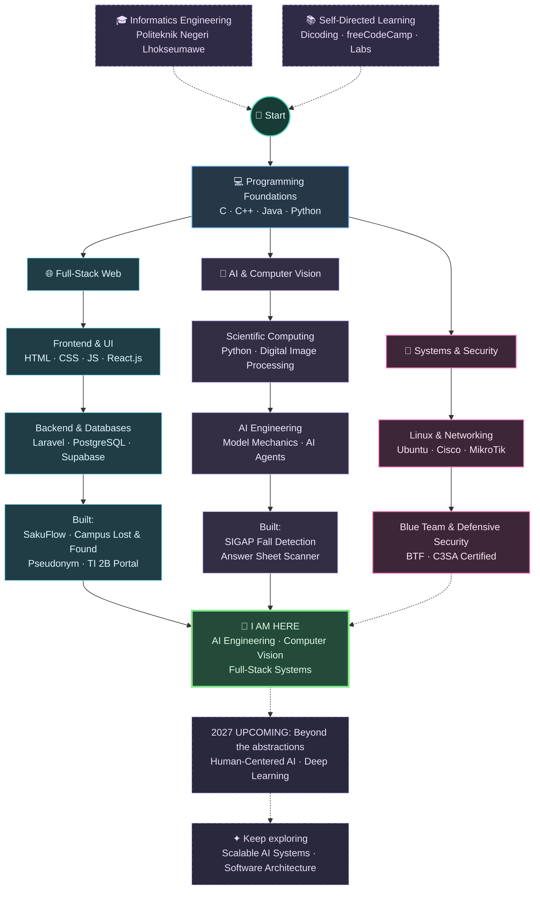

  

<h1 align="center">Alhadi Azumi </h1>

  

  <a href="https://sakuflow-mu.vercel.app">
    <strong>🌐 Featured Project: SakuFlow</strong>
  </a>

  <a href="#projects">Projects</a> ·
  <a href="#my-learning-journey">Journey</a> ·
  <a href="#technologies">Technologies</a> ·
  <a href="#on-my-workbench">Workbench</a> ·
  <a href="#github-activity">Activity</a> ·
  <a href="#elsewhere">Elsewhere</a>

I'm an Informatics Engineering (D4) student at Politeknik Negeri Lhokseumawe based in Aceh, Indonesia. I build full-stack web applications, develop computer vision and AI systems, and enjoy understanding how software works beneath the abstractions.

My interests stretch from responsive web interfaces and backend architecture to computer vision, cybersecurity, and practical AI engineering.

---

## Projects 

A selection of applications, AI experiments, and systems I've built along the way.

### 🤖 AI & Computer Vision

| Project | Under the hood |
| :--- | :--- |
| **[SIGAP](https://github.com/AlhadiAzumi/SIGAP)**   Python · Computer Vision | Real-time CCTV-based fall detection system built for MAKE IT FEST 3 (2nd Place Winner). |
| **[Answer Sheet Scanner](https://github.com/AlhadiAzumi/Website-Pengecekan-Jawaban-Pilgan)**   Python · Image Processing | Automated multiple-choice optical answer sheet scanner and grading web application. |

### 🌐 Full-Stack & Web Applications

| Project | Under the hood |
| :--- | :--- |
| **[SakuFlow](https://sakuflow-mu.vercel.app)** · [Source](https://github.com/AlhadiAzumi/SakuFlow)   Web · WhatsApp Cloud API · Vercel | Personal finance tracking web app integrated with a WhatsApp bot via webhooks. |
| **[Campus Lost & Found](https://campuslostandfound.web.id)** · [Source](https://github.com/AlhadiAzumi/Lost-Found)   Laravel · PostgreSQL · Supabase | Centralized campus lost-and-found portal developed as Project Manager. |
| **[Pseudonym](https://pseudonym.site)** · [Source](https://github.com/AlhadiAzumi/pseudonym)   PostgreSQL · Supabase · Vercel | Anonymous messaging platform migrated from MySQL to Supabase PostgreSQL. |
| **[Cyber-Tasker](https://github.com/AlhadiAzumi/CyberTasker)**   Web · Netlify | Academic task management web app with separate lecturer and student dashboards. |
| **[TI 2B Class Portal](https://datalearnersxxv.my.id)** · [Source](https://github.com/AlhadiAzumi/Website-Kelas-TI-2B-PNL)   React.js · Netlify · Vercel | Official cohort portal and showcase website for Informatics Engineering TI 2B. |

### ⚙️ Software & Systems

| Project | Under the hood |
| :--- | :--- |
| **[TrashChain](https://github.com/AlhadiAzumi/Bank-Sampah-Digital-Berbasis-Java)**   Java · Swing · CLI | Digital waste bank system featuring a web dashboard, Swing GUI, CLI, and CSV persistence. |

---

## My Learning Journey

A map of my journey through computer science, software engineering, and artificial intelligence.

A snapshot of my ongoing path — always iterating, building, and learning.

### 📖 Certifications, Programs & Milestones

| Area | Highlights |
| :--- | :--- |
| **Competitive Programming** | 1st Place — OSN Informatics Kota Langsa (2024) |
| **AI & Computer Vision** | 2nd Place Mini Hackathon MAKE IT FEST 3 (SIGAP) · Dicoding Belajar Dasar AI · Mercor Model Mechanics & Agents |
| **Programs & Cloud** | Pijak 2027 (IBM SkillsBuild × Dicoding) · Scientific Computing with Python (freeCodeCamp) · Google Skills Arcade 2026 |
| **Cybersecurity** | Certified Blue Team Fundamentals (BTF) · Certified Cyber Security Analyst (C3SA) |
| **Campus & Leadership** | Digihub Staff — KOMIT PNL · Executive Secretary — Cyber Day 2026 · Project Manager — Campus Lost & Found |

---

## Technologies 

  <strong>Languages</strong> 
  
  
  
  
  
  
  
  
  

  <strong>AI & Computer Vision</strong> 
  
  
  
  

  <strong>Web & Backend</strong> 
  
  
  
  
  
  
  

  <strong>Tools, Cloud & Infrastructure</strong> 
  
  
  
  
  
  
  
  
  

---

## On my workbench

- **Building:** [SakuFlow](https://github.com/AlhadiAzumi/SakuFlow) — automating personal finance tracking via WhatsApp Cloud API webhooks.
- **Learning:** Computer Vision, AI Agents, and Human-Centered AI through Pijak 2027.
- **Exploring:** Blue-team cybersecurity fundamentals and scalable backend architecture.

---

## GitHub activity 

  <picture>
    <source media="(prefers-color-scheme: dark)" srcset="./assets/overview.dark.svg" />
    
  </picture>

  <picture>
    <source media="(prefers-color-scheme: dark)" srcset="./assets/contributions.dark.svg" />
    
  </picture>

Statistics refreshed daily with GitHub Actions and stored directly in this repository.

---

## Elsewhere

  
  
  
  

---

> _“The constraints imposed in building large software systems are the limitations of our own minds”_
>
> — Harold Abelson